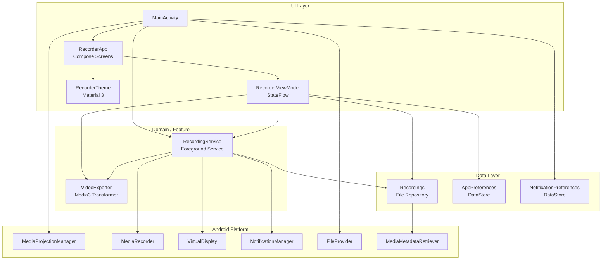
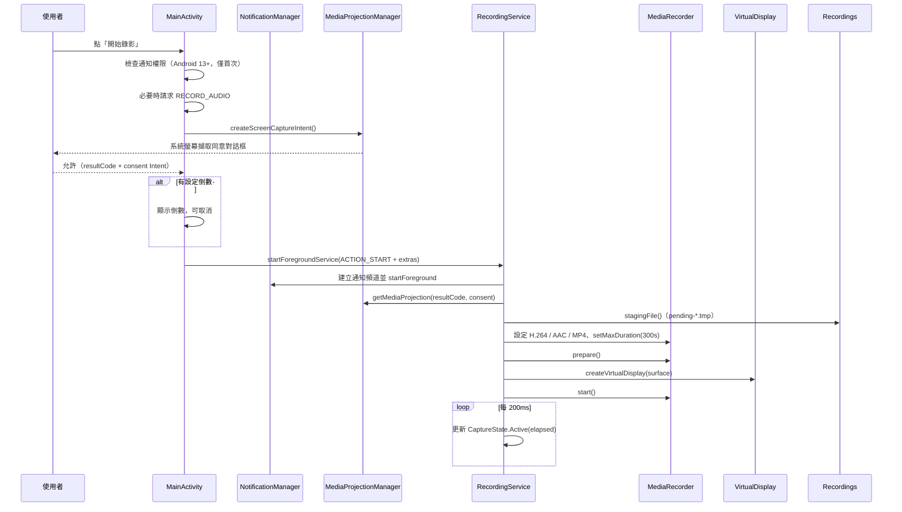
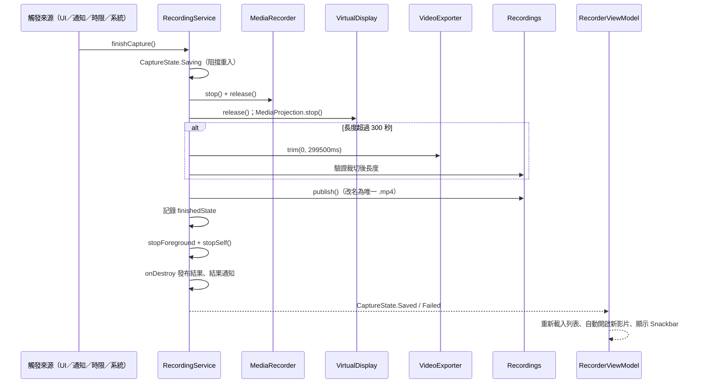
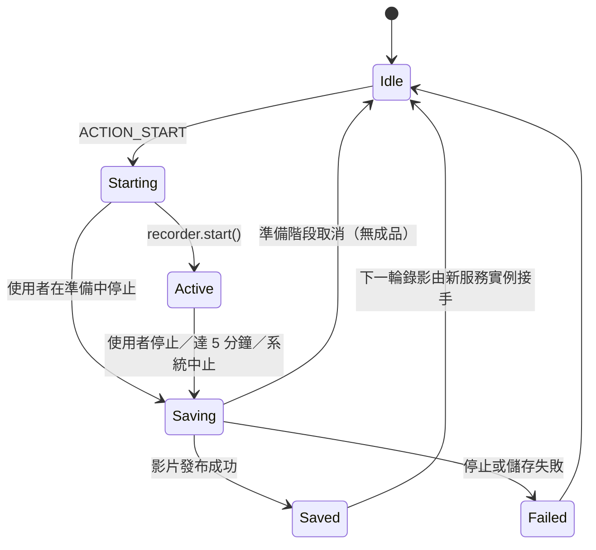

# 系統架構與技術文件

本文件描述「簡單錄影」的技術架構、模組職責、資料流、執行緒模型、建置設定與關鍵設計決策。對應版本 `1.0.0-prerelease`（versionCode 7）。

## 1. 技術基線

| 項目 | 版本／設定 |
| --- | --- |
| 語言 | Kotlin 2.2.20 |
| UI | Jetpack Compose（Compose BOM 2024.12.01）＋ Material 3 |
| 建置 | Gradle 8.13（Wrapper）＋ AGP 8.13.2＋ Version Catalog |
| compileSdk / targetSdk | 36 |
| minSdk | 26 |
| Java / JVM Target | 17 |
| 播放與剪輯 | AndroidX Media3 1.6.1（ExoPlayer、UI、Transformer） |
| 設定儲存 | DataStore Preferences 1.1.7 |
| 生命週期 | Lifecycle 2.8.7 |
| 核心 | core-ktx 1.15.0、activity-compose 1.10.1 |

App ID／namespace：`com.vibecode.simplerecorder`。

## 2. 整體架構

採單一 Activity + Compose + ViewModel 的輕量分層架構，沒有導覽函式庫，畫面切換由 UI 狀態決定。



### 分層職責

| 層級 | 元件 | 職責 |
| --- | --- | --- |
| UI | `MainActivity` | 權限請求、螢幕擷取同意、倒數計時、前景服務啟動／停止、分享 Intent |
| UI | `RecorderApp` 等 Composable | 首頁、設定、預覽、剪輯、全螢幕、對話框；保持無狀態 |
| 狀態 | `RecorderViewModel` | 集中 UI 狀態、載入影片庫、重新命名／刪除／匯出、訂閱服務狀態與設定 |
| 錄影 | `RecordingService` | 前景服務、MediaProjection、VirtualDisplay、MediaRecorder、5 分鐘上限、收尾與結果通知 |
| 剪輯 | `VideoExporter` | 以 Media3 Transformer 進行片段裁切與重新編碼 |
| 資料 | `Recordings` | 影片檔案列舉、metadata 讀取、命名、重新命名、刪除、暫存檔管理 |
| 資料 | `AppPreferences` | 顯示模式、倒數秒數、動態色彩 |
| 資料 | `NotificationPreferences` | 通知權限首次詢問紀錄 |

## 3. 目錄結構

```text
app/src/main/java/com/vibecode/simplerecorder/
├── MainActivity.kt
├── data/
│   ├── AppPreferences.kt
│   ├── NotificationPreferences.kt
│   └── Recordings.kt
├── editing/
│   └── VideoExporter.kt
├── recording/
│   └── RecordingService.kt
└── ui/
    ├── RecorderApp.kt
    ├── RecorderViewModel.kt
    └── theme/
        ├── Color.kt
        └── Type.kt
```

## 4. 錄影資料流

### 4.1 啟動流程



### 4.2 停止與收尾



### 4.3 狀態機

`CaptureState` 為程序內共享的 `StateFlow`（`RecordingService.state`）：



重點規則：

- `finishing` 旗標確保收尾只執行一次。
- 舊服務實例在 `onDestroy` 才發布最終狀態，避免新一輪錄影與舊收尾競爭。
- 若 `MediaRecorder` 因平台時限先停止，改以檔案時長驗證，不重複呼叫 `stop()`。

## 5. 檔案與資料模型

### 5.1 儲存位置

```text
/data/user/0/com.vibecode.simplerecorder/
└── files/
    └── recordings/
        ├── 錄影_20261118_103000.mp4
        └── pending-1234567890.tmp   # 錄影中暫存
```

- 影片存放於 App 私有目錄，不寫入 MediaStore。
- `FileProvider` authority：`${applicationId}.files`，僅開放 `recordings/`。
- 備份規則排除 `recordings/`，且 `allowBackup="false"`。

### 5.2 `Recording` 模型

| 欄位 | 型別 | 說明 |
| --- | --- | --- |
| `file` | `File` | 實際檔案 |
| `durationMs` | `Long` | 影片長度（毫秒） |
| `dateMs` | `Long` | 檔案最後修改時間，作為錄影時間 |
| `displayName` | `String` | 顯示名稱（不含副檔名） |
| `width` / `height` | `Int` | 依 rotation 校正後的畫面尺寸 |
| `aspectRatio` | `Float` | 寬高比，預設 16:9 |

### 5.3 命名規則

- 新錄影：`錄影_yyyyMMdd_HHmmss.mp4`，若重複則附加 `_2`、`_3`。
- 舊版 UUID 檔名在顯示時轉為時間戳名稱。
- 重新命名限制：非空、長度 ≤ 80、不以 `.` 開頭、不含 `\ / : * ? " < > |` 或控制字元、不得同名。

### 5.4 暫存清理

- 每次程序啟動後，首次建立暫存或列出影片時，清除超過 24 小時的 `pending-*.tmp`。
- 以 `synchronized` 與 `stagingCleanupDone` 確保只執行一次。

## 6. 執行緒與協程模型

| 元件 | 排程器 | 說明 |
| --- | --- | --- |
| `RecordingService` | `SupervisorJob + Dispatchers.Main.immediate` | 服務生命週期與狀態更新 |
| 檔案 I/O、metadata | `Dispatchers.IO` | 避免阻塞主執行緒 |
| 收尾清理 | `NonCancellable + Dispatchers.IO` | 保證停止與刪除暫存 |
| `RecorderViewModel` | `viewModelScope` | UI 狀態與背景工作 |
| `VideoExporter` | `Main.immediate` | Media3 Transformer 要求在主執行緒操作 |
| 播放 | ExoPlayer 內部執行緒 | 透過 `PlayerView` 顯示 |

UI 僅訂閱 `StateFlow`，不直接執行 I/O。

## 7. 權限與安全性

```xml
<uses-permission android:name="android.permission.FOREGROUND_SERVICE" />
<uses-permission android:name="android.permission.FOREGROUND_SERVICE_MEDIA_PROJECTION" />
<uses-permission android:name="android.permission.FOREGROUND_SERVICE_MICROPHONE" />
<uses-permission android:name="android.permission.RECORD_AUDIO" />
<uses-permission android:name="android.permission.POST_NOTIFICATIONS" />
```

- 無 `INTERNET` 權限，App 無法上傳資料。`ACCESS_NETWORK_STATE` 由 Media3／ExoPlayer 依賴合併，僅能讀取連線狀態。
- 麥克風與通知皆為使用時請求。
- 螢幕擷取每次由系統對話框授權，同意結果僅以 `Intent` 傳入服務，不持久化。
- 分享使用 `FLAG_GRANT_READ_URI_PERMISSION` 的暫存 URI，不暴露檔案路徑。
- 前景服務類型依 Android 版本與是否使用麥克風動態組合。
- Release／Prerelease 啟用 R8，移除未使用程式碼並混淆名稱。

## 8. 建置設定與變體

```kotlin
buildTypes {
    debug { versionNameSuffix = "-debug" }
    release {
        isMinifyEnabled = true
        isShrinkResources = true
        proguardFiles(getDefaultProguardFile("proguard-android-optimize.txt"), "proguard-rules.pro")
    }
    create("prerelease") {
        initWith(getByName("release"))
        signingConfig = signingConfigs.getByName("debug")
        versionNameSuffix = "-prerelease"
    }
}
```

| Build Type | R8 | 資源縮減 | 簽署 | versionName 範例 | 用途 |
| --- | --- | --- | --- | --- | --- |
| `debug` | 否 | 否 | Debug | `1.0.0-debug` | 開發與日常測試 |
| `prerelease` | 是 | 是 | Debug 金鑰 | `1.0.0-prerelease` | 內部測試、GitHub Pre-release |
| `release` | 是 | 是 | 正式金鑰（需自行設定） | `1.0.0` | 正式上架 |

版本來源集中於 `gradle/libs.versions.toml` 的 `appName` 與 `appCode`。

建置指令：

```powershell
.\gradlew.bat assembleDebug
.\gradlew.bat assemblePrerelease
.\gradlew.bat assembleRelease
.\gradlew.bat lintDebug
```

## 9. 關鍵設計決策

| 決策 | 理由 |
| --- | --- |
| 單 Activity + Compose 狀態導覽 | 畫面數量少，避免引入 Navigation 依賴與額外狀態 |
| 前景服務負責錄影 | 切到其他 App 時仍可持續錄影，符合平台限制 |
| 服務層級 `StateFlow` | 讓 Activity／ViewModel 不因設定變更或重建而遺失錄影狀態 |
| 先寫暫存再發布 | 避免失敗時留下看似完成的影片，並可清理過期暫存 |
| 以檔案時長驗證上限 | 平台可能提前停止錄影，單靠 callback 不可靠 |
| Media3 Transformer 剪輯 | 與 ExoPlayer 同生態，支援裁切與進度回報 |
| 影片存私有目錄 | 不需要儲存權限，降低隱私風險；代價是解除安裝即刪除 |
| 固定 4:3 預覽框 | 與舊版一致，避免直式影片在清單頁佔用過多高度 |

## 10. 相依套件

| 套件 | 用途 |
| --- | --- |
| `androidx.activity:activity-compose` | Compose Activity、權限與結果 API |
| `androidx.compose:compose-bom` / `material3` | UI 與 Material 3 設計語言 |
| `androidx.lifecycle:*` | ViewModel、生命週期感知狀態收集 |
| `androidx.core:core-ktx` | 相容性工具與 Foreground Service 輔助 |
| `androidx.datastore:datastore-preferences` | 設定儲存 |
| `androidx.media3:media3-exoplayer` / `media3-ui` | 影片播放 |
| `androidx.media3:media3-transformer` | 影片剪輯匯出 |

所有版本統一由 `gradle/libs.versions.toml` 管理。

## 11. 測試與驗證

- 目前無單元測試來源；以 `assembleDebug`、`lintDebug` 與實機驗收為主。
- 驗收項目見 [系統設計文件的驗收清單](DESIGN.md#13-驗收清單) 與 [使用指南](USER_GUIDE.md)。
- R8 版本需特別驗證：錄影、播放、剪輯、分享、重新命名與通知流程。
