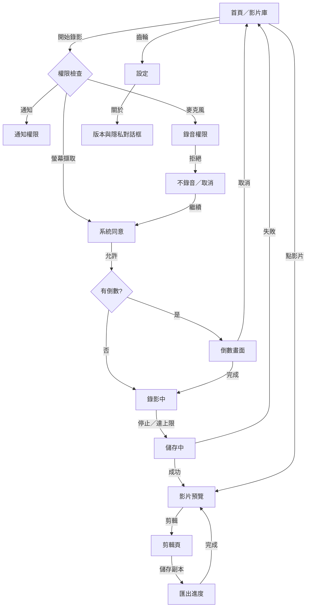

# 系統設計文件

本文件說明「簡單錄影」的產品目標、需求、介面設計、狀態處理、驗收標準與後續演進方向。對應版本 `1.0.0-prerelease`。

## 1. 文件目的與範圍

- 對象：維護者、測試人員與後續開發者。
- 範圍：Android App 本體（錄影、影片庫、播放、剪輯、設定、發布流程）。
- 不在範圍：正式商店上架流程、後端服務（本專案無後端）、多語系在地化。

## 2. 背景與目標

多數螢幕錄影 App 功能龐雜、含廣告或需要帳號。本專案針對「快速錄一小段畫面」的情境，提供低認知負擔、離線、私密的工具。

### 2.1 目標

1. 三步內開始錄影：開 App → 按開始 → 允許系統擷取。
2. 預設安全：不錄音、不上傳、不申請不必要的權限。
3. 錄影一定有結束：5 分鐘上限、到時自動停止並儲存。
4. 基本影片管理自足：預覽、重新命名、剪輯、分享、刪除。
5. 適度個人化：顯示模式、倒數秒數、動態色彩。

### 2.2 非目標

- 專業剪輯（多軌、字幕、轉場）。
- 直播、雲端同步、帳號系統。
- 長時間錄影或背景通話錄音。
- 系統相簿整合與跨 App 媒體庫管理。

### 2.3 成功指標（質性）

- 首次使用者不看說明也能完成一次錄影。
- 錄影失敗時不會留下無法辨識的殘檔。
- 使用者能清楚知道影片存放位置與刪除後果。

## 3. 使用者與情境

| 角色 | 情境 | 需求 |
| --- | --- | --- |
| 一般使用者 | 錄製操作教學片段 | 快速開始、可選旁白、自動停止 |
| 開發／測試人員 | 錄製 Bug 重現步驟 | 短片、易分享、可重新命名 |
| 教師／講者 | 錄製畫面搭配講解 | 倒數、麥克風、剪掉頭尾 |
| 重視隱私者 | 不願上傳雲端 | 離線、私有儲存、無網路權限 |

## 4. 功能需求

| 編號 | 需求 | 優先級 |
| --- | --- | --- |
| FR-01 | 支援螢幕錄影並輸出 MP4（H.264） | 必要 |
| FR-02 | 每段錄影上限 5 分鐘，到時自動停止並儲存 | 必要 |
| FR-03 | 可選擇是否錄製麥克風旁白，預設關閉 | 必要 |
| FR-04 | 錄影前可設定 0／3／5／10 秒倒數，倒數可取消 | 必要 |
| FR-05 | 錄影中提供 App 內與通知兩種停止方式 | 必要 |
| FR-06 | 影片庫顯示縮圖、名稱、日期與長度 | 必要 |
| FR-07 | 支援播放、全螢幕、螢幕恆亮與音訊焦點處理 | 必要 |
| FR-08 | 支援重新命名，含格式驗證與同名阻擋 | 必要 |
| FR-09 | 支援頭尾剪輯並另存副本，原始影片保留 | 必要 |
| FR-10 | 支援系統分享與刪除（需二次確認） | 必要 |
| FR-11 | 設定頁支援顯示模式與動態色彩 | 次要 |
| FR-12 | 關於頁顯示版本、授權與隱私說明 | 次要 |
| FR-13 | 通知權限被拒時仍可完成錄影與停止 | 必要 |
| FR-14 | 異常中止時不留下未完成影片 | 必要 |

## 5. 非功能需求

| 類別 | 要求 |
| --- | --- |
| 相容性 | Android 8.0（API 26）以上；Android 13+ 通知權限、Android 14+ 部分螢幕分享 |
| 效能 | 錄影不阻塞 UI；1080p 以下以 30fps／4Mbps 為基準；清單以 IO 執行緒載入 |
| 儲存 | 影片存 App 私有目錄；逾 24 小時暫存自動清除；發布前驗證可播放與時長 |
| 隱私 | 無網路權限、無分析 SDK、備份排除錄影檔 |
| 可用性 | 空狀態、載入中、錯誤皆有畫面；破壞性操作需確認 |
| 無障礙 | 可點擊元素具 `contentDescription`；重要訊息使用 live region |
| 可維護性 | 版本集中管理；UI 無狀態；I/O 與協程分層 |

## 6. 資訊架構與畫面流程



### 6.1 畫面清單

| 畫面 | 主要元件 | 狀態 |
| --- | --- | --- |
| 首頁 | 錄影卡、麥克風開關、近期錄影清單 | 待機／準備中／錄影中／儲存中 |
| 倒數覆層 | 大型數字、取消提示、取消按鈕 | 3／5／10 秒 |
| 麥克風拒絕對話框 | 說明、不錄音繼續、取消 | — |
| 影片預覽 | 播放器、全螢幕、分享、剪輯、重新命名、刪除 | 播放／錯誤 |
| 剪輯 | 範圍滑桿、片段預覽、儲存副本、匯出進度 | 編輯／匯出 |
| 設定 | 顯示模式、動態色彩、倒數、關於 | — |
| 全螢幕播放 | 播放器、關閉 | 系統列隱藏 |

## 7. 互動與視覺設計

- **設計語言**：Material 3，元件以 `Scaffold`、`TopAppBar`、`Card`、`ListItem`、`Switch`、`SegmentedButton` 為主。
- **間距**：4dp 倍數；設定頁列高至少 48dp，區塊間距 2dp（緊湊版）。
- **圓角**：12dp（Material 3 預設卡片與按鈕）。
- **色彩**：主色 `RecorderBlue #285AA5`、深色主色 `#ABC7FF`；Android 12+ 可改用桌布動態色彩。
- **字型**：Material 3 `Typography`；僅將 `displayLarge` 調整為 114sp 供倒數使用。
- **深色模式**：跟隨系統／強制淺色／強制深色，狀態列圖示同步調整。
- **Edge-to-edge**：`enableEdgeToEdge()` + `Scaffold` 內距處理。
- **返回鍵**：以 `BackHandler` 依序關閉全螢幕／剪輯／設定／預覽；倒數中返回鍵視為取消。
- **回饋**：操作結果以 Snackbar 顯示；錄影中顯示計時器、進度條與剩餘時間提醒。
- **無障礙**：清單項目以「名稱，日期，長度」作為 `contentDescription`；倒數使用 `liveRegion = Polite`。

## 8. 資料設計

### 8.1 實體

| 實體 | 儲存 | 欄位 |
| --- | --- | --- |
| 影片 | 檔案系統（MP4） | 檔名、時長、修改時間、寬高 |
| App 設定 | DataStore `app_preferences` | `theme_mode`、`countdown_seconds`、`dynamic_color` |
| 通知狀態 | DataStore `recorder_preferences` | `notifications_prompted` |

### 8.2 狀態資料

`RecorderUiState` 聚合畫面所需狀態：

```text
recordings: List<Recording>?      // null = 載入中
openingRecording: Boolean          // 由通知指定檔名開啟中
microphone: Boolean
capture: CaptureState              // Idle/Starting/Active/Saving/Saved/Failed
selected: Recording?               // 非 null 表示在預覽頁
editing: Boolean
range: ClosedFloatingPointRange<Float>
exportProgress: Int?               // null = 未匯出
message: Int?                      // Snackbar 字串資源
notificationsOff: Boolean
showSettings: Boolean
themeMode / countdownSeconds / dynamicColor
```

### 8.3 資料保留

- 影片：直到使用者刪除或解除安裝。
- 設定：DataStore，解除安裝時移除。
- 暫存：成功發布後刪除；失敗或中斷時於收尾刪除；逾 24 小時由下次啟動清理。

## 9. 狀態與錯誤處理

| 情境 | 行為 | 使用者回饋 |
| --- | --- | --- |
| 使用者取消螢幕擷取 | 不啟動服務 | 「未取得螢幕擷取同意，沒有開始錄影。」 |
| 通知權限被拒 | 繼續錄影 | 首頁提示通知未開啟 |
| 麥克風權限被拒 | 顯示選擇對話框 | 可「不錄音，繼續」或取消 |
| 準備中停止 | 不產生成品，回到待機 | 無錯誤，避免殘檔 |
| 達 5 分鐘 | 自動停止，必要時裁切再發布 | 「已達錄影上限，影片已儲存」 |
| 系統中止擷取 | 收尾並刪除暫存 | 「錄影已中斷，沒有儲存影片。」 |
| 儲存失敗 | 刪除暫存 | 「無法儲存影片…」 |
| 匯出取消 | 刪除暫存輸出 | 回到剪輯頁 |
| 影片損毀 | 不列入清單或播放錯誤 | 「無法播放這支影片。」 |
| 分享失敗 | 捕捉例外 | 「無法分享這支影片。」 |

原則：

1. 失敗時優先確保不留下半成品。
2. 錯誤訊息使用字串資源，避免寫死文案。
3. 收尾流程不可取消（`NonCancellable`）。

## 10. 隱私與安全設計

- 不宣告 `INTERNET`，從根本避免上傳。
- 影片存於 App 私有目錄，其他 App 無法直接讀取。
- 分享才短暫授予單一檔案讀取權限。
- `allowBackup="false"`，且 backup 與 data extraction 規則排除 `recordings/`。
- 不蒐集裝置識別碼、位置或使用行為。
- Pre-release 使用 Debug 金鑰，僅供測試；正式發布須改用專用金鑰。

## 11. 效能與資源設計

- 錄影解析度限制：短邊 ≤ 720、長邊 ≤ 1280，並對齊偶數，降低編碼負擔。
- 影片位元率 4Mbps、30fps；音訊 AAC 96kbps／44.1kHz／單聲道。
- 狀態更新頻率 200ms，兼顧計時顯示與耗電。
- 縮圖於 IO 執行緒擷取，尺寸 144×96；Android 8.0 使用 `getFrameAtTime` 後備。
- 清單延遲載入；通知開啟指定影片時只讀取該檔。
- 播放器離開畫面即釋放；`ON_STOP` 時暫停。

## 12. 版本與發布設計

| 版本 | versionCode | 用途 |
| --- | --- | --- |
| `1.0.0-prerelease` | 7 | GitHub Pre-release 測試版（R8 + Debug 簽署） |
| `1.0.0` | 7 | 未來正式版（需正式簽署） |

- `prerelease` 繼承 `release` 的 R8 與資源縮減設定。
- 發布檔名統一為 `app-prerelease.apk`。
- GitHub Release 必須勾選 **Pre-release**，並在說明標示「不是正式上線版本」。
- 每次功能變更遞增 `versionCode`；`versionName` 採 `主.次.修`。

## 13. 驗收清單

1. 關閉麥克風錄一段，切到其他 App 後從通知停止；確認 MP4 可播放且無音軌。
2. 開啟麥克風錄影並說話；確認回放有旁白、聲畫同步。拒絕麥克風權限時可選擇只錄畫面。
3. 錄到 5 分鐘，確認自動停止、長度不超過上限；另測取消擷取授權、鎖屏與系統停止。
4. 剪輯有旁白的影片並另存副本，確認聲畫同步、原片保留；分享副本可被其他 App 開啟；取消匯出不留殘檔。
5. 拒絕通知權限時仍可從首頁停止；另測低儲存空間與刪除確認。
6. 顯示「準備中」時分別從首頁與通知停止，確認不產生成品；正常錄完後可立即再錄。
7. 影片庫大量影片時，由儲存完成通知開片可進入該影片；回首頁仍可載入列表。
8. 放置過期與未過期的 `pending-*.tmp`，重啟後僅清除過期檔，既有影片可播放。
9. 全螢幕切換不中斷播放、返回鍵可退出；重新命名後列表、預覽與分享檔名一致，非法名稱被阻擋。
10. 切換三種顯示模式並重啟，選擇保留；設定倒數後開錄，倒數結束才出現系統同意對話框。
11. 直式與橫式錄影預覽以 4:3 顯示；播放中螢幕不熄滅；縮圖與「日期・長度」正常。
12. 倒數時點畫面與按取消都能回首頁；重新命名自動全選、完成鍵可儲存；Android 12+ 動態色彩生效且重啟保留。

## 14. 未來擴充

- 可調整錄影長度與解析度。
- 錄製內部音訊（Android 10+ `AudioPlaybackCapture`）。
- 匯出至系統相簿（MediaStore）。
- 批次刪除、搜尋與排序。
- 單元測試與 UI 測試。
- 多語系（英文）與無障礙強化。
- 正式簽章與自動化發布流程（CI）。

## 15. 風險與對策

| 風險 | 影響 | 對策 |
| --- | --- | --- |
| OEM 對前景服務限制不同 | 背景錄影被中止 | 收尾刪除暫存並提示；實機驗證 |
| 平台提前停止錄影 | 檔案長度異常 | 以檔案時長驗證，必要時裁切 |
| R8 混淆造成反射失效 | 執行時崩潰 | 保留預設優化規則；發布前完整驗收 |
| 儲存空間不足 | 無法錄影或儲存 | 事前檢查與錯誤提示 |
| 使用者誤刪影片 | 資料遺失 | 二次確認；文件說明無法復原 |
